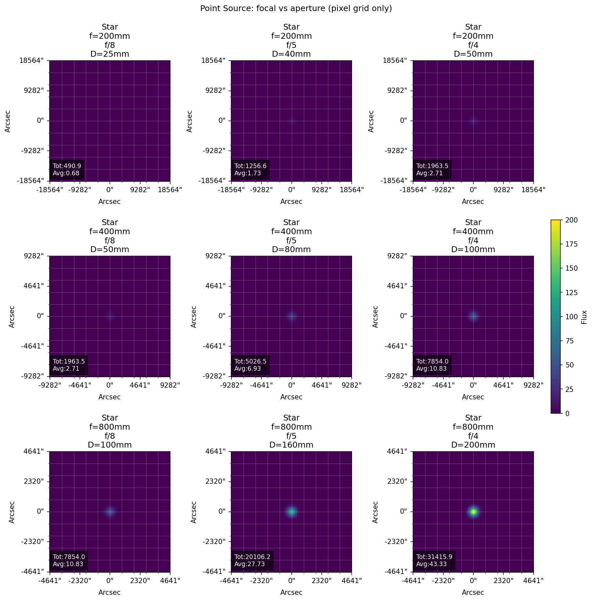

# astro-lab

Tools for deep-sky and exoplanet astrophotography, in one repository. The centrepiece is astro-piper, a Python orchestrator that drives PixInsight through generated scripts to process narrowband images. Around it sit tools for sensor characterization, calibration diagnostics, session quality and transit photometry.

Designed and specified by the owner; built by directing AI coding agents.

## Highlights

### astro-piper: PixInsight automation by code generation

PixInsight is the standard image-processing application in astrophotography. It has a JavaScript scripting runtime, PJSR (PixInsight JavaScript Runtime). astro-piper does not click through the PixInsight interface. It writes a complete PJSR script for each step, runs PixInsight in headless automation mode, and checks the result.

- `astro-piper/pjsr_generator.py` (2,420 lines) has one generator function per PixInsight process: calibration, star alignment, local normalization, integration, drizzle, the RC-Astro BlurXTerminator, NoiseXTerminator and StarXTerminator plugins, stretches, the Foraxx palette, curves, HDR (high dynamic range) multiscale transform, spectrophotometric color calibration and star recombination.
- `astro-piper/orchestrator.py` sequences 32 stages across 5 phases: 1 linear preprocessing, 2 linear processing, 3 stretching, 4 nonlinear finishing, 5 RGB (red, green, blue) stars and final merge. A separate Phase 0 builds master bias, dark and flat frames (`calibration_master_builder.py`).
- 6 stages are breakpoints. The pipeline pauses there for a human decision (crop, sharpening, stretch, hue, star blend) and every other step runs unattended.
- Every stage writes a JSON log: inputs, parameters, wall-clock time, exit code and a SHA-256 hash of each output file.

Run `python orchestrator.py --config pipeline_config.json --list-stages` to print the stage table.

### Pipeline state is the files on disk

Each stage declares its input and output files. A stage is complete when all its outputs exist (`PipelineStage.is_complete` in `orchestrator.py`). A rerun skips completed stages, so an interrupted run resumes where it stopped with no state database. `--force` reruns everything and `--start-stage` resumes from a named stage.

### Calibration diagnostic plugin for PixInsight

`astro-piper/pixinsight-scripts/CascadiaPhotoelectric/CascadiaPhotoelectric-CalibrationDiagnostic.js` is a PixInsight script with its own dialog. It calibrates a chosen subset of light frames with dark, flat and bias masters switched on or off, and can run all three combinations (dark and flat, dark only, flat only) side by side to isolate a calibration fault.

- It mirrors the ImageCalibration settings that `pjsr_generator.generate_image_calibration` emits, so the interactive check matches what the pipeline does.
- It reads the filter from the file names and finds the matching master flat.
- It records the conditions of each test (target, gain, sensor temperature, airmass, moon phase, sky brightness, seeing) to `diagnostic_log.json`, so results can later be grouped by conditions rather than judged one session at a time.

Two companion scripts build masters (`MasterBuilder.js`) and score the last run (`ScoreLastRun.js`). `pixinsight-scripts/install.py` copies them into a PixInsight installation.

### Sensor read-noise characterization

`camera-noise/camera_noise_characterization.py` reads bias frames from a cooled CMOS (complementary metal-oxide-semiconductor) camera and groups them by gain and set temperature from the FITS (Flexible Image Transport System) headers. For each group it converts ADU (analog-to-digital units) to electrons with the header's EGAIN value, and fits a Gaussian and a kernel density estimate to the pixel distribution. The output is a read-noise value in electrons for each gain and temperature group, written to a summary CSV (comma-separated values) file, with a fit plot per group and an overlay that compares the groups.

## Repository map

| Folder | Language | What it does |
|---|---|---|
| `astro-piper/` | Python, PJSR | Narrowband processing orchestrator, script generator, PixInsight plugins, design document (`design_doc.md`) |
| `camera-noise/` | Python | Read noise against temperature and gain from bias frames |
| `flatfield-analyzer/` | Python | Statistics, master flats and illumination maps from a folder of flat frames; a WBPP (WeightedBatchPreprocessing) setup guide |
| `flatfield-sim/` | TypeScript, React | Browser simulator for designing an LED (light-emitting diode) flat panel, with printable jig designs |
| `optical-modeling/` | Python | How focal length, f-number and pixel count spread flux across a sensor |
| `session-quality/` | Python | HTML dashboard scoring a night's guiding, autofocus, altitude and efficiency |
| `focus-analyzer/` | Python | Parses NINA (Nighttime Imaging 'N' Astronomy) autofocus logs into focus-position workbooks |
| `transit-photometry/` | Python, AstroImageJ macros | Exoplanet transit target selection, photometry and light-curve modeling |
| `focal/` | Python | Early scaffold of an INDI (Instrument Neutral Distributed Interface) client for calibration experiments |
| `astrolib/` | Python | Shared helpers (FITS headers, log parsing, coordinates, ephemeris) and an older target-planning script |

`ARCHITECTURE.md` explains the folder layout. `INVENTORY.md` lists the functions in each tool.



*Output of `optical-modeling/fnumber_pixel_grid.py`: a star's flux on the pixel grid for 3 focal lengths and 3 f-numbers.*

## Tests

The test suite covers astro-piper. It needs Python 3.11 and pytest, and nothing else: PixInsight and GraXpert calls are mocked, and generated scripts are checked as text.

```bash
cd astro-piper
python -m pytest tests -q
```

Measured result: 293 passed. Of these, 122 test the script generator.

Run pytest on the `tests` folder. `astro-piper/scripts/spike_test.py` is a manual feasibility check against a real PixInsight installation, not a pytest module, and pytest reports errors if it collects it.

## What needs PixInsight and real data

The tests prove the generated scripts have the right structure. They do not prove the images come out right. An end-to-end run of astro-piper needs:

- PixInsight on Windows, with the RC-Astro BlurXTerminator, NoiseXTerminator and StarXTerminator plugins.
- GraXpert for background extraction and denoising.
- Narrowband and RGB light frames, and calibration frames, at the paths set in `astro-piper/pipeline_config.json`.

The other tools run on FITS files or NINA logs from a real session. `transit-photometry` also needs AstroImageJ. `flatfield-sim` runs in a browser with `npm install` and `npm run dev`.

## Setup

Each folder is self-contained, with its own `requirements.txt` where it has dependencies.

```bash
cd camera-noise
python -m venv .venv
.venv\Scripts\activate
pip install -r requirements.txt
python camera_noise_characterization.py -d <folder of bias frames>
```

Observer location in `session-quality/config.yaml` is a regional default rounded to 0.1 degree. Set your own site before using the altitude analysis.

FITS and XISF image data, virtual environments and generated outputs are not committed. See `.gitignore`.

## License

[MIT](LICENSE)
